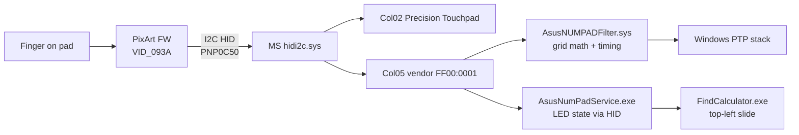
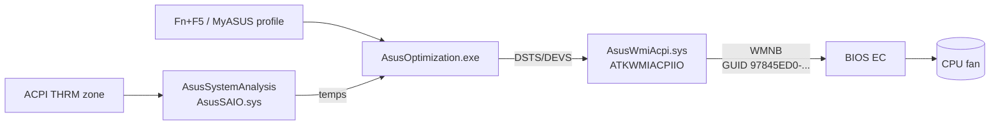

# Architecture — E1404FA control paths

How the three features work on stock Windows, and what the Linux port
replaces. IDs are verified on the author's unit; see `HARDWARE.md`.

## NumberPad toggle + backlight (Windows)

Linux replaces `FLT`+`SVC` with `asus-numberpad-driver` (libevdev/uinput
for keys, 13-byte I2C frame for backlight). The I2C frame and layout math
are the port surface — see `../numpad/README.md`.

## Fan / thermal (Windows)

Linux replaces `OPT` with `asus-wmi` sysfs (`fan_boost_mode`,
`throttle_thermal_policy`) or `asusctl`. Candidate device IDs, in probe
order: `0x00110019`, `0x00110018`, `0x00120075`, `0x00110011` — see
`../fan/README.md`. `../tools/Probe-AsusWMI.ps1` reads them on Windows first.

## Corner NumLock LED

On Windows it follows NumberPad state via the `Col05` channel
(`SetLEDState`/`GetLEDState` in the service binary). On Linux the grid
backlight (I2C level byte) and this LED appear to be separate paths —
newer `ASUP14xx` units light the grid while the LED stays dark. Treat as
its own investigation: `../touchpad-led/README.md`.

## Design rules for this repo

- Docs + read-only probes only; no ASUS binaries, no EC writes.
- One fact lives in one place (`../numpad/`, `../fan/`, `../touchpad-led/`); this
  file only maps how they connect.
- Every hardware claim names the tool that produced it
  (`../tools/Dump-E1404FA.ps1`, `install.sh --check-only`, `DSDT.dsl`).
